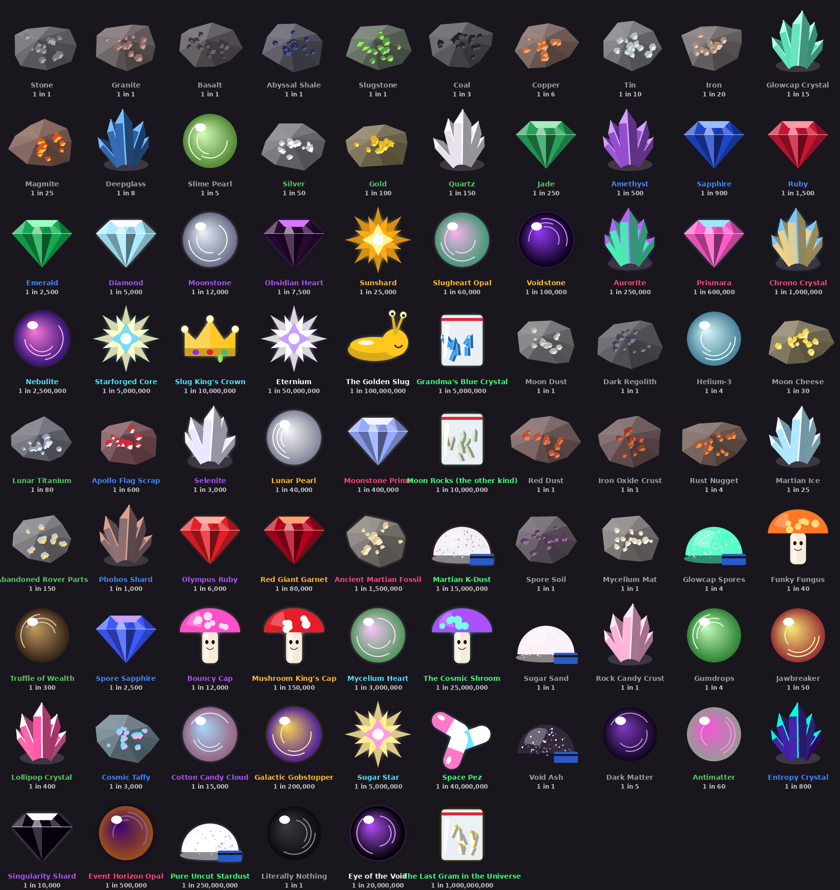

# 🚀 Astro Tweakin

A crude little space-mining incremental game for Discord. Start in the slug caves of **Slug Earth**, build rockets, and work your way across 3 realms and 7 planets. There are 86 ores, from **Stone** (1 in 1) to **The Last Gram in the Universe** (1 in 1,000,000,000). Every planet hides one ultra-rare piece of joke 🚨 contraband. Rare finds get their own animated reveal and a server-wide shout.

| Realm | Planets | Contraband |
|---|---|---|
| 🌌 The Milky Way | 🌍 Slug Earth, 🌕 The Moon, 🔴 Mars | Grandma's Blue Crystal, Moon Rocks (the other kind), Martian K-Dust |
| 🍄 The Trippy Dimension | 🍄 Shroomtopia, 🍭 Candy Nebula | The Cosmic Shroom, Space Pez |
| 🕳️ The Void Realm | ⚫ The Singularity, ⬛ The Nothing | Pure Uncut Stardust, The Last Gram in the Universe |

Flying to a new planet costs coins, rare ores and rocket parts you build in the 🔧 Workshop. Warping to a new realm also needs a Warp Core or Void Engine.

## Playing

`/mine` opens your mine. Everything else is buttons.

| | |
|---|---|
| ⛏️ Mine | Rolls for ores. Each ore has a "1 in N" chance and your luck divides N. |
| 🎰 Lucky Roll | Spins a reel every 10 minutes: coins, x1.5 to x10 luck, haste or double dig. |
| 💰 Sell | Sells ores. Keeps Epic+ ores, bars and the materials for your next pickaxe. |
| 🛒 Shop | Craft the next pickaxe, dig deeper / launch / warp, hire sluglings, smelt bars. |
| 🔧 Workshop | Build rocket parts (fuel, hull, nav computer, oxygen, warp core...) from ores. |
| 🐌 Collect | Sluglings dig 1 ore a minute each while you're offline (up to 12h). |
| `/rebirth` | "Burn the lab down" at Slug Core with 50M coins: reset for +50% luck and +25% sell value forever. |

Also `/travel` (jump to any place you've unlocked), `/index`, `/profile`, `/leaderboard`, `/help`.

**Smuggler's Run (v0.3.0)**

| | |
|---|---|
| 🚔 Cargo checks | Carry Legendary+ ore (especially contraband) and the Space Authority may pull you over. Hide it, smooth talk, distract the K-9, bribe, or dump it. Busted = fine + your cheapest hot ore seized. |
| 🚀 `/ship` | Hidden Compartments (fewer checks), Reinforced Hull (raid defense), Turbo Engine (raids and duels), paint. |
| 🏴‍☠️ `/raid @player` | Luck check for stuff they "forgot" on their ship. The target never loses anything. |
| ⚔️ `/duel @player [bet]` | Best-of-3 laser duel, optional coin bet both players agree to. |
| 🍬 `/snacks` | Cook boosts from coins + your layer's base ore. |
| 📜 `/bounties` | Three daily jobs. |
| 🏆 `/achievements`, `/title` | Every achievement is a title you can wear. |
| ☄️ Meteor | Hits the announce channel once a day at a random time (sometimes more). First 5 to mine it get loot. |
| 👽 Tweaker Tim | Shady trader who shows up about 3 times a day for 10 minutes. His picture is `assets/tim.png`. |

Meteors and Tim post in the channel set with `/admin announce` (or `ANNOUNCE_CHANNEL_ID`). Without one they don't appear.

Admins (Manage Server, or listed in `ADMIN_USER_IDS`): `/admin announce`, `/admin event`, `/admin give`, `/admin backup`, `/admin restart`, `/admin preview`, `/admin meteor`, `/admin tim`, `/admin cops` (sends a cargo check at yourself to test it).

## Running it on your PC

1. Install **Python 3.11 or newer** from python.org (tick "Add python.exe to PATH" in the installer).
2. Double-click `start.bat`. The first run sets everything up and opens `.env` in Notepad.
3. Paste your bot token into `.env` (see below), save, and run `start.bat` again.

Leave the window open; the bot runs as long as it's open and restarts itself if it crashes.
To start it when Windows boots: press `Win+R`, type `shell:startup`, and put a shortcut to `start.bat` in that folder.

## Creating the Discord bot

1. Go to <https://discord.com/developers/applications> → **New Application** → name it Astro Tweakin.
2. **Bot** tab → **Reset Token** → copy it into `DISCORD_TOKEN` in `.env`. Treat it like a password.
3. **Installation** tab (or OAuth2 → URL Generator): scopes `bot` and `applications.commands`; permissions **Send Messages**, **Embed Links**, **Attach Files**, **Use External Emojis**, **Read Message History**. Open the link to invite it to your server.
4. In Discord turn on Developer Mode (Settings → Advanced), then right-click your server → **Copy Server ID** into `GUILD_ID`, and right-click yourself → **Copy User ID** into `ADMIN_USER_IDS`.
5. In your server run `/admin announce #channel` to pick where rare finds get shouted.

## Update notes with a webhook

1. In your updates channel: ⚙️ Edit Channel → **Integrations** → **Webhooks** → **New Webhook** → **Copy Webhook URL**, and paste it into `UPDATE_WEBHOOK_URL` in `.env`.
2. Put any GIFs and images you like in the `update_images` folder. Each update post picks one at random (anything over Discord's 10 MB limit is skipped).

**It's automatic from here.** Every new notes file in `updates/` (like `updates/0.2.0.md`, where the first `# ` line is the title) gets posted by the bot the next time it starts. Posted files are remembered in `updates/posted.txt`, so nothing posts twice. To restart without touching the PC, use `/admin restart` in Discord.

To post one by hand, double-click `post_update.bat` (it posts the newest notes) or run `post_update.bat updates\0.1.0.md`.

## Keeping player data safe

Everything is saved in `astro_tweakin.db` next to the bot. Here's how it's protected:

- **All-or-nothing saves.** Every button press is saved as one unit. A crash, error or power cut mid-action rolls it back instead of half-applying it (no paying for a pickaxe you didn't get).
- **No negatives or dupes.** Coins and items can't go below zero, and double-clicking can't run the same action twice at once.
- **Written to disk immediately**, so a finished action survives a power cut.
- **Automatic backups** go to the `backups` folder when the bot starts, every 30 minutes, and when it stops. The newest 48 are kept, plus one a day for 30 days. `/admin backup` makes one on demand. Set `BACKUP_DIR` in `.env` to a OneDrive or Google Drive folder to keep a copy off this PC too.
- **Startup check.** If the save file is ever damaged, the bot refuses to start instead of overwriting it.
- **Restoring.** Close the bot, run `restore_backup.bat`, and pick a backup. Your current save is renamed, never deleted.
- **Updates never wipe data.** New versions add to the save file in place.

## Custom ore art

Every image is drawn in code (`game/images.py`). To use your own art for an ore, save a square PNG with a transparent background as `assets/ores/<ore key>.png`, for example `assets/ores/sunshard.png`. Ore keys are in `game/data.py`. Good free generators for this: Microsoft Designer / Bing Image Creator (free, DALL·E based), ChatGPT's free image generation, or Google Gemini. A prompt that works well: *"single glowing purple crystal ore, game item icon, centered, transparent background, stylized, no text"*.

Keep the bot in your own servers. Discord's public app directory doesn't like drug jokes, even fake ones..

## Tweaking the game

All numbers live in `game/data.py`: ores, chances, values, realms, planets, layers, rocket parts, pickaxes, lucky roll prizes and rebirth. `python -m tools.simulate` shows what each layer drops, and `python -m tools.render_all` renders every ore and a few reveal GIFs into `assets/preview/`.
